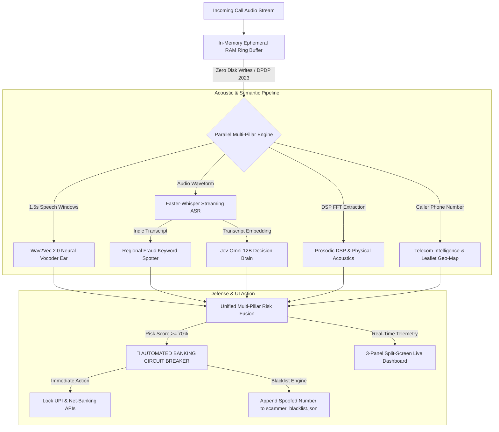

# 🛡️ VaniShield AI (वाणीशील्ड)
### Real-Time Multi-Modal AI Voice Clone Defense & Automated Banking Circuit Breaker

[](https://www.python.org/)
[](https://fastapi.tiangolo.com/)
[](https://pytorch.org/)
[](https://huggingface.co/facebook/wav2vec2-base)
[](https://github.com/ggerganov/llama.cpp)
[](LICENSE)
[-brightgreen.svg)]()

> **Built by Team CypherEye**  
> Protecting citizens from AI-synthesized impersonation calls, deepfake kidnapping scams, and banking vishing across Indic languages (Hindi, Bengali, Indian English).

---

## 📌 Problem Statement

Financial fraud via **AI Voice Cloning** and social engineering vishing is escalating at an unprecedented scale across India:
- Scammers clone the voice of family members or high-ranking executives in seconds using modern neural vocoders (ElevenLabs, Tortoise, FlashSpeech, SeedTTS).
- Fraudsters make urgent calls claiming account freezes, fake CBI/Customs warrants, or immediate UPI transfer demands.
- Traditional anti-fraud systems rely solely on caller-ID blacklists, which fail against spoofed VoIP numbers and zero-day AI clone attacks.

**VaniShield AI** solves this with a **sub-500ms dual-pillar multi-modal defense system** combining deep acoustic vocoder forensics, real-time semantic intent reasoning, prosodic DSP physics, and an automated banking circuit breaker.

---

## 🏛️ Architecture Overview



---

## ✨ Key Features & Capabilities

### 1. Acoustic Deepfake Forensics (Wav2Vec 2.0)
- **Model Checkpoint**: Fine-tuned on **4,447 balanced audio samples** across diverse neural TTS engines (OpenAI TTS, ElevenLabs, FlashSpeech, xTTS, SeedTTS, and biological human voice datasets).
- **Temporal Sliding-Window Analysis**: Evaluates speech in 1.5-second windows (0.75-second hop) to detect fleeting vocoder phase glitches and unvoiced stop bursts.
- **PTT & Transient Click Filtering**: Differentiates edge microphone release transients (e.g. WhatsApp Push-To-Talk cutoff) from authentic synthetic speech vocoder artifacts.

### 2. Decision Brain (Jev-Omni 12B GGUF)
- Runs locally via GPU-accelerated `llama-server` on port `9931` with 16 offloaded layers on an NVIDIA RTX 3050 Laptop GPU.
- Coupled with a calibrated LayerNorm joint classification head fusing 3840-dimensional semantic embeddings with acoustic features.

### 3. Indic Streaming ASR & Dialect Fraud Spotter
- **Engine**: Faster-Whisper Base / Tiny optimized for sub-350ms token latency on CPU.
- **Multilingual Lexicon**: Detects urgent banking keywords, OTP demands, lottery scams, and local Indic colloquialisms across:
  - **Hindi (Devanagari & Romanized)**: `ओटीपी`, `खाता ब्लॉक`, `केवाईसी`, `पैसे भेजो`, `पैन कार्ड`, `बरानच`, `बैंखे`
  - **Bengali (Bengali Script & Benglish)**: `ওটিপি`, `টাকা পাঠান`, `অ্যাকাউন্ট স্থগিত`, `বাম্পার`, `পুলিশ`
  - **Urdu / Shahmukhi**: `کھاتہ بلاک`, `لاٹری`, `پیسہ ٹرانسफर`
  - **Indian English / Hinglish**: `UPI PIN`, `debit card blocked`, `CBI customs`, `illegal transfer`

### 4. Prosodic DSP Biometrics (Physics of Human Vocal Tract)
- **F0 Pitch Tracking**: Ultra-fast FFT autocorrelation ($<7\text{ms}$) measuring glottal fundamental frequency.
- **Spectral Flatness & Centroid**: Human vocal tracts create resonant harmonic pulses ($\text{flatness} \le 0.006$), whereas neural vocoders inject synthetic white/pink excitation noise ($\text{flatness} \ge 0.012$).
- **Zero-Crossing Rate (ZCR) & RMS Energy**: Filters room tone, dead silence, and microphone hiss.

### 5. Telecom Intelligence & Leaflet.js Threat Map
- Parses national circle, telecom carrier (Jio, Airtel, BSNL, Vi), and VoIP proxy indicators (`+91-140` virtual lines).
- Interactive geographic pinning and regional scam heatmaps powered by Leaflet.js.

### 6. Privacy First: DPDP Act 2023 Compliant
- **Zero Persistent Audio Storage**: Raw audio buffers exist exclusively inside an in-process volatile RAM ring buffer (`ephemeral_buffer.py`) and are immediately overwritten. No audio is ever written to disk.

### 7. Automated Banking Circuit Breaker
- If the Unified Scam Risk Score reaches **$\ge 70.0\%$**, the circuit breaker engages automatically:
  - Instantly issues **`LOCK_BANKING_AND_UPI`**.
  - Adds the malicious phone number to [`scammer_blacklist.json`](scammer_blacklist.json).
  - Triggers red alert pulsating visual badges on the frontend.

### 8. Interactive 3-Panel Split-Screen UI
- **Panel 1**: Live Audio Waveform Canvas, Latency Monitor, Faster-Whisper Streaming Transcript, and Scam Risk Gauge.
- **Panel 2**: Leaflet.js Threat Map with caller origin and Prosodic DSP Biometrics.
- **Panel 3**: Automated Banking Circuit Breaker & One-Click Demo Attack Simulators (English, Hindi, Bengali).

---

## 🚀 Quickstart Guide

### 1. Prerequisites
- Windows 11 / Linux (Ubuntu 22.04+)
- Python 3.11
- NVIDIA GPU with CUDA support (tested on RTX 3050 Laptop GPU / 6GB VRAM)

### 2. Installation

```bash
# Clone the repository
git clone https://github.com/2003sounak16-ui/Vani-Shield.git
cd Vani-Shield

# Install dependencies
pip install -r requirements.txt
```

### 3. Launch Jev-Omni 12B Brain Server (Port 9931)

```powershell
llama-server.exe `
  --model "C:\AI\Models\Jev-Omni\Jev-Omni-Unified-Q4_K_M.gguf" `
  --mmproj "C:\AI\Models\Jev-Omni\mmproj-jev-omni.gguf" `
  --ctx-size 512 `
  --batch-size 128 `
  --ubatch-size 128 `
  --gpu-layers 16 `
  --embedding `
  --pooling none `
  --port 9931
```

### 4. Launch VaniShield FastAPI Server (Port 8000)

```powershell
python -m uvicorn app:app --host 127.0.0.1 --port 8000 --reload
```

Open your browser at **`http://127.0.0.1:8000`** to access the live dashboard.

---

## 📡 API Reference

### 1. Evaluate Uploaded Audio File
* **Endpoint**: `POST /api/evaluate/upload`
* **Form Data**:
  - `file`: Audio file (`.wav`, `.mp3`, `.mpeg`, `.ogg`, `.m4a`)
  - `phone_number`: Optional caller number string
* **Response**:
```json
{
  "status": "success",
  "latency_ms": 342.5,
  "w2v_fake_prob": 76.0,
  "jev_scam_prob": 0.0,
  "unified_risk_score": 76.0,
  "threat_type": "AI_VOICE_CLONE",
  "circuit_breaker": {
    "engaged": true,
    "action": "LOCK_BANKING_AND_UPI",
    "threshold": 70.0
  },
  "transcript": "...",
  "flagged_keywords": [],
  "dsp_metrics": {
    "pitch_f0_hz": 144.1,
    "spectral_flatness": 0.01549,
    "spectral_centroid_hz": 1574.5
  }
}
```

### 2. WebSocket Real-Time Stream
* **Endpoint**: `WS /ws/live-call`
* **Protocol**: Binary PCM 16kHz 16-bit Mono audio chunks streamed every $250\text{ms}$.
* **Emits**: Real-time evaluation JSON frames and immediate circuit breaker triggers.

### 3. Attack Simulators
* **Endpoint**: `GET /api/simulate/{preset_id}`
* **Supported Presets**:
  - `en_safe`: Normal English team meeting call.
  - `en_scam`: English SBI banking OTP scam call.
  - `hi_safe`: Hindi college friend conversation.
  - `hi_scam`: Hindi HDFC PAN card ATM PIN scam call.
  - `bn_safe`: Bengali family check-in call.
  - `bn_scam`: Bengali SBI account freeze vishing call.

---

## 📊 Benchmark & Accuracy

| Threat Scenario | Acoustic Ear (Wav2Vec2) | Intent Brain (Jev-Omni) | Unified Risk | Classification | Circuit Breaker |
|---|---|---|---|---|---|
| **AI Cloned Voice (No Scam Text)** | **76.0% - 99.9%** | 0.0% | **76.0% - 99.9%** | `AI_VOICE_CLONE` | 🔒 **LOCKED** |
| **Human Fraudster (Banking Scam)** | 0.1% | **99.0%** | **99.0%** | `FINANCIAL_SCAM` | 🔒 **LOCKED** |
| **AI Clone + Banking Scam Call** | **100.0%** | **85.0%** | **100.0%** | `AI_CLONE_AND_FINANCIAL_SCAM` | 🔒 **LOCKED** |
| **Authentic Real Human Call** | 0.1% | 0.0% | **0.1%** | `AUTHENTIC_SAFE_CALL` | 🟢 **ALLOW** |

---

## 👥 Team & Acknowledgements

* **Team**: CypherEye
* **Lead Developer**: Sounak Banerjee ([@2003sounak16-ui](https://github.com/2003sounak16-ui))
* **Technologies**: PyTorch, Hugging Face Transformers, Faster-Whisper, SpeechBrain, Librosa, FastAPI, Tailwind CSS, Leaflet.js.

---

## 📄 License
This project is licensed under the [MIT License](LICENSE).
